# Customer Churn Prediction & Retention Intelligence Platform

An end-to-end machine learning product for a telecom retention team: it predicts which customers are likely to leave, explains why, groups customers into segments, and suggests retention actions. It's built in Python, served as an 8-page Streamlit app and packaged with Docker.

Every number in this README was **measured** by the pipeline scripts in this repository. Nothing is estimated or invented.

| Headline (one-time evaluation on 1,409 held-out test customers) | Result |
|---|---|
| Deployed model | Logistic regression (elastic net), chosen by a pre-registered rule |
| ROC-AUC | **0.8435** (95% bootstrap CI 0.8205 to 0.8646) |
| PR-AUC | **0.6414** (95% CI 0.5867 to 0.6932); base rate 0.265 |
| Brier score / calibration error (ECE) | **0.1371** / **0.0202**; mean predicted 0.266 vs observed 0.265 |
| At the deployed threshold (0.40) | Recall **66.6%** (249 of 374 churners), precision **58.5%**, 30.2% of customers flagged |
| Automated tests | **283 passed**, 0 failed, 0 skipped; line coverage **92.9%** |

---

## Table of contents

1. [Business problem](#business-problem)
2. [Architecture](#architecture)
3. [Dataset](#dataset)
4. [Technology stack](#technology-stack)
5. [Algorithms implemented](#algorithms-implemented)
6. [Model benchmarking results](#model-benchmarking-results)
7. [Hyperparameter tuning results](#hyperparameter-tuning-results)
8. [Calibration and thresholds](#calibration-and-thresholds)
9. [Final model selection](#final-model-selection)
10. [Explainability](#explainability)
11. [Customer segmentation](#customer-segmentation)
12. [Risk bands and retention recommendations](#risk-bands-and-retention-recommendations)
13. [Application features](#application-features)
14. [Project structure](#project-structure)
15. [Installation (Windows CMD)](#installation-windows-cmd)
16. [Running the pipeline (Windows CMD)](#running-the-pipeline-windows-cmd)
17. [Running the app](#running-the-app)
18. [Docker](#docker)
19. [Testing](#testing)
20. [Experiment tracking and reproducibility](#experiment-tracking-and-reproducibility)

---

## Business problem

A subscription business loses revenue every time a customer leaves. A retention team can call customers, offer contract incentives or fix service issues, but its time and budget are limited. It needs to know:

1. **Who** is most likely to leave (a calibrated churn probability per customer).
2. **Why** the model thinks so (drivers it can discuss with the customer).
3. **What** to try (suggestions linked to those drivers).
4. **How many** to contact, given the cost of an offer and the value of a saved customer.

Errors cost different amounts. A **false negative** (a churner nobody contacts) loses that customer's revenue. A **false positive** (a loyal customer who gets an offer) costs an incentive and staff time. Accuracy is therefore not the selection criterion: predicting "nobody churns" would already score 73.5% accuracy on this data.

## Architecture

```mermaid
flowchart LR
    A[Raw CSV] --> B[Validate and fingerprint]
    B --> C[Stratified split 60/20/20]
    C -->|train| D[Benchmark: 13 models x 5 strategies, 5-fold CV]
    D --> E[Tune 5 shortlisted models]
    E --> F[Calibrate and choose thresholds on validation]
    F --> G[Pre-registered selection rule]
    G --> H[One-time test evaluation]
    H --> I[Final pipeline + metadata.json]
    C -->|train| K[K-Means segmentation]
    I --> L[SHAP explanations]
    I --> J[PredictionService]
    K --> J
    L --> J
    J --> M[Streamlit app, 8 pages]
    M --> N[Docker image]
```



Each layer only talks to the layer below it:

| Layer | Responsibility | Package |
|---|---|---|
| Config and logging | Paths, seed, thresholds, placeholder business costs; rotating log file | `config.yaml`, `src/churn/config`, `src/churn/utils` |
| Data | Load, validate against a data contract, SHA-256 fingerprint, EDA | `src/churn/data` |
| Features | Fix `TotalCharges`, engineer 6 features, impute/scale/one-hot | `src/churn/features` |
| Modeling | Registry, imbalance strategies, benchmark, tuning, calibration, thresholds, selection | `src/churn/models` |
| Explainability | Permutation importance, SHAP global and local | `src/churn/explain` |
| Analytics | Segmentation, risk bands, recommendation rules | `src/churn/analytics` |
| Serving | `PredictionService`: validate, score, explain, suggest; never trains | `src/churn/serving` |
| Frontend | Streamlit pages that only call the service and read saved artifacts | `app` |

Two rules hold throughout: **training and serving share one saved pipeline**, so inference can't drift from training, and **the app never trains**, so every number on screen traces back to a script run. Details: [docs/architecture.md](docs/architecture.md). Key decisions and their evidence: [docs/decisions.md](docs/decisions.md).

## Dataset

[IBM Telco Customer Churn](https://www.kaggle.com/datasets/blastchar/telco-customer-churn) (Kaggle, `blastchar/telco-customer-churn`).

| Property | Value |
|---|---|
| Rows × columns | 7,043 customers × 21 columns (19 inputs, ID, `Churn` target) |
| Churn rate | 26.5% (moderate imbalance) |
| Split | Stratified 60/20/20, seed 42: **4,225 train / 1,409 validation / 1,409 test** |
| File fingerprint | SHA-256 prefix `88be4b93fbe0` (recorded with every model and run) |
| Known quirk | Blank `TotalCharges` for brand-new customers, set to 0 when tenure is 0 (never billed) |

**Data notice.** The full CSV is not stored in this repository. Download it with the Kaggle CLI (script `01`). The app needs a small subset (`artifacts/serving/`: 200 training rows for SHAP and the 1,409 validation rows for the dashboards). Check the dataset's terms on Kaggle before redistributing it further.

## Technology stack

| Area | Tools |
|---|---|
| Language and environment | Python 3.12, Windows Command Prompt, `venv` |
| Data and statistics | pandas, NumPy, SciPy (chi-square, Cramér's V, Mann-Whitney U, Spearman) |
| Machine learning | scikit-learn, imbalanced-learn, XGBoost, LightGBM, CatBoost |
| Explainability | SHAP, scikit-learn permutation importance |
| Visualization | Matplotlib, Seaborn (static reports), Plotly (interactive app) |
| Experiment tracking | MLflow (local SQLite store, no server) |
| Application | Streamlit (8 pages) |
| Testing | pytest, pytest-cov, Streamlit `AppTest` |
| Packaging | Docker, Docker Compose, joblib model serialization |

## Algorithms implemented

| Family | Models |
|---|---|
| Classical | Logistic Regression, KNN, Decision Tree, Gaussian Naive Bayes, SVM (RBF) |
| Ensembles | Random Forest, Extra Trees, AdaBoost, Gradient Boosting, HistGradientBoosting |
| Gradient boosting libraries | XGBoost, LightGBM, CatBoost |

**Imbalance strategies compared:** no resampling, class weights, random oversampling, random undersampling, SMOTE. Every sampler runs **inside** an `imblearn` pipeline, so it only touches training folds.

Four combinations are not applicable (class weights on KNN, Gaussian NB, AdaBoost and Gradient Boosting, which have no class-weight parameter), leaving **61 runs × 5 folds = 305 fits**.

The optional **Explainable Boosting Machine (InterpretML)** was not implemented. See [Future improvements](#future-improvements).

## Model benchmarking results

Stage 1, 5-fold stratified cross-validation on the training split, default settings. Best strategy per model, by PR-AUC:

| Model | Best strategy | ROC-AUC | PR-AUC | Recall @0.5 | Precision @0.5 | Fit s/fold |
|---|---|---|---|---|---|---|
| AdaBoost | SMOTE | 0.8495 | 0.6724 | 0.726 | 0.560 | 2.01 |
| Logistic Regression | none | 0.8491 | 0.6716 | 0.546 | 0.657 | 0.11 |
| Gradient Boosting | none | 0.8444 | 0.6667 | 0.506 | 0.664 | 2.40 |
| CatBoost | class weights | 0.8442 | 0.6626 | 0.737 | 0.551 | 2.79 |
| XGBoost | class weights | 0.8397 | 0.6610 | 0.745 | 0.538 | 0.86 |
| Random Forest | class weights | 0.8446 | 0.6606 | 0.736 | 0.550 | 1.66 |
| HistGradientBoosting | class weights | 0.8346 | 0.6508 | 0.688 | 0.546 | 2.30 |
| Extra Trees | class weights | 0.8394 | 0.6485 | 0.715 | 0.552 | 1.61 |
| SVM (RBF) | none | 0.8001 | 0.6449 | 0.476 | 0.690 | 0.23 |
| LightGBM | random over | 0.8349 | 0.6400 | 0.633 | 0.584 | 0.52 |
| Gaussian NB | SMOTE | 0.8264 | 0.6260 | 0.831 | 0.484 | 0.10 |
| Decision Tree | class weights | 0.8204 | 0.6058 | 0.791 | 0.489 | 0.13 |
| KNN | none | 0.8242 | 0.6032 | 0.562 | 0.602 | 0.09 |

**Findings:**
- **The top models are statistically tied.** The top 9 runs span 0.0048 ROC-AUC, smaller than the uncertainty of each mean (fold std 0.013 to 0.016, so roughly ±0.006 for a 5-fold mean).
- **Boosting did not beat logistic regression** at default settings. The signal (contract, tenure, internet type) is close to additive.
- **Imbalance strategies move the threshold, not the model.** Averaged by strategy, ROC-AUC ranges only 0.8336 to 0.8368 while recall at 0.5 ranges from 0.538 to 0.789.
- **Balancing damages probability quality.** Logistic regression's Brier score is 0.1340 with no resampling vs 0.1612 to 0.1646 with balancing. Strategy `none` was therefore used from Stage 2 on, and recall was controlled by an explicit threshold.

## Hyperparameter tuning results

Stage 2 tuned the shortlist with 5-fold CV on the training split, on the same folds as the benchmark: grid search for logistic regression (24 candidates), randomized search for the rest (40 candidates each). Selection metric: PR-AUC. All runs logged to MLflow.

| Model | CV PR-AUC (±std) | Default | Δ PR-AUC | CV ROC-AUC | Overfit gap | Search time |
|---|---|---|---|---|---|---|
| Gradient Boosting | 0.6772 (±0.016) | 0.6667 | +0.0106 | 0.8509 | 0.056 | 3.1 min |
| XGBoost | 0.6770 (±0.019) | 0.6596 | +0.0174 | 0.8511 | 0.026 | 1.0 min |
| CatBoost | 0.6749 (±0.016) | 0.6560 | +0.0189 | 0.8514 | 0.066 | 4.3 min |
| AdaBoost | 0.6734 (±0.022) | 0.6664 | +0.0070 | 0.8522 | 0.016 | 2.9 min |
| Logistic Regression | 0.6718 (±0.025) | 0.6716 | +0.0002 | 0.8491 | 0.010 | 0.6 min |

Every booster chose **shallow, heavily regularized** settings (XGBoost `max_depth=2`, `reg_lambda` 17.4; Gradient Boosting depth 3, `min_samples_leaf=50`; AdaBoost decision stumps). That independently confirms the near-additive signal. Logistic regression chose `C=3.0`, `l1_ratio=0.5` (elastic net, `saga` solver).

## Calibration and thresholds

Every tuned model was fitted on the training split and scored once on the validation split: uncalibrated, and with sigmoid or isotonic calibration fitted inside the training split.

| Model (best variant) | ROC-AUC | PR-AUC | Brier | ECE |
|---|---|---|---|---|
| Gradient Boosting (uncalibrated) | 0.8404 | 0.6508 | 0.1364 | 0.021 |
| CatBoost (uncalibrated) | 0.8387 | 0.6505 | 0.1365 | 0.024 |
| Logistic Regression (uncalibrated) | 0.8356 | 0.6475 | 0.1380 | 0.030 |
| XGBoost (uncalibrated) | 0.8383 | 0.6463 | 0.1372 | 0.028 |
| AdaBoost (sigmoid) | 0.8379 | 0.6462 | 0.1376 | 0.022 |

- **Calibration rescued AdaBoost:** Brier 0.1704 → 0.1376 and ECE 0.172 → 0.022 with sigmoid scaling.
- **Isotonic calibration was rejected:** lower PR-AUC and higher log loss for every model.
- **Threshold policies** were chosen on validation: `default_0.5`, `max_f1`, `recall_target` (recall ≥ 0.80) and `max_net_benefit`. For every model the net-benefit optimum (0.34 to 0.40) sat just above the theoretical break-even of 0.333 for calibrated probabilities. Business costs in `config.yaml` are **placeholders**.

## Final model selection

The rule was written **before** the test split was opened:

1. Per model, use the uncalibrated pipeline unless sigmoid lowers validation Brier by more than 0.001 (isotonic excluded).
2. The reference is the variant with the highest validation PR-AUC.
3. A variant is eligible if the paired-bootstrap 95% interval of (reference − variant) PR-AUC contains 0 and its Brier score is within 0.005 of the best.
4. Choose the simplest eligible variant (logistic regression < gradient boosting < AdaBoost < XGBoost < CatBoost).

**All five variants were statistically tied** with the reference (gradient boosting). The rule chose **logistic regression, uncalibrated**: PR-AUC gap 0.0032 (95% CI −0.0141 to 0.0224), the smallest overfitting gap (0.010), interpretable coefficients, no calibration wrapper and the simplest deployment. Threshold policy: `max_net_benefit`, which is 0.40 on validation.

**One-time test evaluation (1,409 customers, 26.5% churn):**

| Metric | Validation | Test |
|---|---|---|
| ROC-AUC | 0.8356 | **0.8435** |
| PR-AUC | 0.6475 | **0.6414** |
| Brier | 0.1380 | **0.1371** |
| Recall at 0.40 | 0.658 | **0.666** |
| Precision at 0.40 | 0.604 | **0.585** |

| Test metrics at each stored threshold | Threshold | Precision | Recall | F1 | Specificity | MCC | Flagged |
|---|---|---|---|---|---|---|---|
| default_0.5 | 0.50 | 0.638 | 0.519 | 0.572 | 0.894 | 0.443 | 21.6% |
| max_f1 / max_net_benefit (deployed) | 0.40 | 0.585 | 0.666 | 0.623 | 0.829 | 0.476 | 30.2% |
| recall_target | 0.24 | 0.491 | 0.816 | 0.613 | 0.695 | 0.454 | 44.1% |

At the deployed threshold the model catches 249 of 374 churners and raises 177 false alarms. A list built this way contains churners at 2.2 times the base rate. Validation and test agree within their intervals, so the validation-based choices did not overfit.

## Explainability

Computed on the validation split (permutation importance, 20 repeats; SHAP linear explainer, 200-customer background; additivity error 1.8e-15).

| Driver | Evidence |
|---|---|
| Tenure | Largest by every measure: permutation PR-AUC drop 0.359; 23.3% of SHAP; −1.37 log-odds per standard deviation |
| Contract | Month-to-month odds ×2.21; two-year ×0.41 (12.0% of SHAP) |
| Internet service | Fiber optic odds ×3.09 (11.7% of SHAP) |
| Security and support | Engineered `no_security_or_support`: odds ×1.65 |
| Charges | `TotalCharges` permutation drop 0.160; `MonthlyCharges` 0.074 |
| Payment method | Permutation drop 0.004, worse than chance in only 60% of shuffles, so effectively weak in this model |

The elastic-net penalty set 11 of 50 encoded coefficients to zero. Some single-feature signs look surprising (for example `tenure_group 61+` "raises risk") because correlated features share information: the linear tenure term overshoots for long-tenured customers and the band corrects it. The app therefore groups related features into driver families. **Explanations describe what the model relies on, not what causes churn.**

## Customer segmentation

K-Means on 8 standardized attributes (tenure, monthly charges, log total charges, add-on count, contract level, internet type). **The churn label was not an input.** Chosen k = 6 by a pre-declared rule: highest silhouette for k = 3 to 8 with bootstrap stability ≥ 0.80 and every segment ≥ 5%.

Silhouette 0.461 ("reasonable" structure), bootstrap stability 0.92, Ward hierarchical agreement ARI 0.857, DBSCAN ARI 0.656. Validation churn per segment is within ±2.2 points of training.

| Segment (generated name) | Share | Avg tenure | Avg monthly | Churn | Lift |
|---|---|---|---|---|---|
| S1: New, low-spend, no internet, month-to-month | 10.7% | 10.5 | 20.47 | 13.7% | 0.52 |
| S2: Established, low-spend, DSL, month-to-month | 18.6% | 13.9 | 49.30 | 30.5% | 1.15 |
| S3: Established, high-spend, fiber, month-to-month | 24.6% | 14.4 | 84.11 | **58.9%** | **2.22** |
| S4: Long-standing, low-spend, no internet, two-year | 10.8% | 49.1 | 21.78 | 0.9% | 0.03 |
| S5: Long-standing, mid-spend, DSL, two-year | 16.3% | 54.9 | 68.55 | 5.2% | 0.20 |
| S6: Long-standing, high-spend, fiber, mixed contracts | 19.0% | 56.9 | 100.97 | 20.9% | 0.79 |

**S3 holds about 55% of all churners** (612 of 1,121 in training), so it's the core retention target. S6 combines moderate risk with the highest revenue per customer.

## Risk bands and retention recommendations

Bands use the calibrated probability and the validation thresholds. Checked on validation customers:

| Band | Rule | Customers | Mean predicted | Observed churn |
|---|---|---|---|---|
| Low | p < 0.24 | 797 (56.6%) | 7.7% | 9.2% |
| Medium | 0.24 ≤ p < 0.40 | 205 (14.5%) | 31.4% | 26.8% |
| High | 0.40 ≤ p < 0.70 | 310 (22.0%) | 54.7% | 55.2% |
| Critical | p ≥ 0.70 | 97 (6.9%) | 76.6% | 77.3% |

The **recommendation engine** is a set of 8 transparent rules (contract incentive, onboarding, security/support trial, fiber service review, high-value loyalty, bill-increase review, autopay, assisted support). Each is labelled **model driver** (backed by the explainability results) or **business heuristic**. Suggestions are ordered by each customer's own SHAP driver families.

> Recommendations are rule-based suggestions, separate from the model's prediction. Their effect on churn has not been measured; test them, for example with a controlled A/B test, before rolling them out.

## Application features

| Page | What it does |
|---|---|
| Home | Model card, how it works, artifact status |
| 1 · Executive Dashboard | KPIs, revenue at risk, risk bands, observed vs predicted churn by segment, main drivers |
| 2 · Churn Prediction | Form for one customer: probability, decision, band, segment, SHAP drivers, suggestions, consistency warnings |
| 3 · Batch Prediction | CSV upload, file and row-level validation, scoring, rejected rows with reasons, CSV export |
| 4 · Risk Analysis | Threshold trade-offs, editable business assumptions, band calibration check, customer explorer |
| 5 · Segmentation | Profiles, interactive PCA map, choosing k, per-segment exploration |
| 6 · Model Benchmarking | 13×5 heatmaps, ROC/PR curves, confusion matrices, tuning, calibration, learning curves, final test results |
| 7 · Explainable AI | Global importance, SHAP summary, coefficients, any validation customer explained, dependence plots |
| 8 · Retention Recommendations | Capacity-limited contact list, rule catalogue, rule statistics |

A decision-threshold slider in the sidebar is shared by all pages except the test-set results, which always use the stored threshold.

## Project structure

```
customer-churn-platform\
├── app\                     Streamlit app: main.py, pages\ (8), components\
├── src\churn\               Installable package
│   ├── config\              settings.py (typed config)
│   ├── data\                schema, validator, loader, fingerprint, EDA
│   ├── features\            cleaning, engineering, preprocessing, splitting
│   ├── models\              registry, imbalance, pipeline, benchmark, tuning,
│   │                        calibration, threshold, candidates, selection, final
│   ├── explain\             permutation, shap_explainer, plots
│   ├── analytics\           segmentation, risk, recommendations, plots
│   ├── serving\             predictor.py (PredictionService)
│   └── utils\               logger, tracking (MLflow)
├── scripts\                 00 to 12: one pipeline step each
├── tests\                   unit\ and integration\
├── artifacts\               models, metrics, plots, EDA, SHAP, segmentation, serving
├── docs\                    architecture, decisions, test report, screenshots
├── config.yaml              seed, split, thresholds, placeholder business costs
├── Dockerfile, docker-compose.yml, .dockerignore
├── requirements.txt, requirements-dev.txt, requirements-app.txt, requirements-lock.txt
└── pyproject.toml
```

## Installation (Windows CMD)

Requires Python 3.12 (64-bit) and Git. All commands are for **Windows Command Prompt**.

```
git clone https://github.com/<your-username>/customer-churn-platform.git
cd customer-churn-platform
python -m venv .venv
.venv\Scripts\activate.bat
python -m pip install --upgrade pip
python -m pip install -r requirements-lock.txt
python -m pip install -e .
python scripts\00_check_environment.py
```

`requirements-lock.txt` installs the exact versions this project was trained and tested with (recommended, because a saved model should be loaded with the same scikit-learn version). `requirements-dev.txt` installs the latest compatible versions instead.

The trained artifacts are committed, so **the app runs straight after installation** without retraining.

## Running the pipeline (Windows CMD)

Run from the project root with the environment active. Each script logs to the console and to `logs\churn.log`.

| Step | Command | Output |
|---|---|---|
| 0 | `python scripts\00_check_environment.py` | Verifies every library imports |
| 1 | `python scripts\01_download_data.py` | Dataset in `data\raw` (needs Kaggle credentials) |
| 1b | `python scripts\01b_inspect_data.py` | Data profile and validation report |
| 2 | `python scripts\02_run_eda.py` | `artifacts\eda`: statistics, plots, `eda_report.md` |
| 3 | `python scripts\03_prepare_data.py` | Stratified splits in `data\processed`, feature checks |
| 4 | `python scripts\04_benchmark_models.py` | 61 CV runs: `artifacts\metrics\benchmark`, plots |
| 5 | `python scripts\05_tune_models.py --n-jobs 8` | Tuned models, results, MLflow runs |
| 6 | `python scripts\06_calibrate_and_threshold.py --n-jobs 8` | Validation comparison, thresholds, learning curves |
| 7 | `python scripts\07_finalize_model.py` | Selection on validation (dry run; test not loaded) |
| 7 | `python scripts\07_finalize_model.py --evaluate-test` | **One-time** test evaluation, final pipeline and metadata |
| 8 | `python scripts\08_explain_model.py --n-jobs 8` | Permutation importance, SHAP, `explain_report.txt` |
| 9 | `python scripts\09_run_segmentation.py` | Segment model, profiles, report |
| 10 | `python scripts\10_build_recommendations.py` | Risk bands, rule statistics, report |
| 11 | `python scripts\11_prepare_serving.py` | Small serving files for the app and Docker |
| 12 | `python scripts\12_test_report.py` | `docs\test_report.md` (after running the tests) |

`--n-jobs` sets parallel fits. Step 7 refuses to evaluate on the test split a second time unless `--force` is given, and every rerun is counted in `metadata.json`.

## Running the app

```
python -m streamlit run app\main.py
```

Open http://localhost:8501. Press **Ctrl + C** in CMD to stop.

## Docker

Requires Docker Desktop (WSL 2 backend). The image contains only runtime dependencies, pinned to the versions in `requirements-lock.txt`, runs as a non-root user and has a health check.

| Task | Command |
|---|---|
| Build | `docker build -t churn-intelligence:latest .` |
| Run | `docker run -d --name churn-intelligence -p 8501:8501 -v churn-logs:/app/logs churn-intelligence:latest` |
| Status and health | `docker ps` |
| Health endpoint | `curl http://localhost:8501/_stcore/health` |
| Logs | `docker logs -f churn-intelligence` |
| Stop / start / restart | `docker stop churn-intelligence` · `docker start churn-intelligence` · `docker restart churn-intelligence` |
| Remove container / image | `docker rm -f churn-intelligence` · `docker rmi churn-intelligence:latest` |
| Compose: build and start | `docker compose up -d --build` |
| Compose: logs / stop | `docker compose logs -f` · `docker compose down` |

## Testing

```
python -m pytest tests --cov --cov-report=term-missing --cov-report=xml:artifacts\tests\coverage.xml --junitxml=artifacts\tests\junit.xml
python scripts\12_test_report.py
```

**Latest recorded run** ([docs/test_report.md](docs/test_report.md)): **273 tests passed, 0 failed, 0 skipped**, in 142 seconds. Line coverage **92.9%**, branch coverage **71.4%** across `src/churn` and `app`.

| Layer | What is tested |
|---|---|
| Unit (synthetic data) | Validation rules, cleaning, feature engineering, splitting, every model and strategy, metrics, tuning, calibration, thresholds, bootstrap selection, SHAP additivity, segmentation, rules, the prediction service, chart builders, Docker files |
| Integration (real artifacts) | Real data contract, split reproducibility, data fingerprint, end-to-end scoring of raw rows, saved-model reproduction of stored predictions, metadata contract, test metrics recomputed from saved predictions |
| Application | Every page runs headlessly; form submission; page interactions; a real Streamlit server starts and reports healthy |
| Command line | Environment check; scripts reject invalid arguments |

**Upload path:** the headless test harness cannot simulate a browser file upload, so the Batch Prediction page also offers built-in sample sources that feed the same bytes through the same code. The tests use them to run the full results view (scoring, rejected rows with reasons, charts, export). Only the upload widget itself is not exercised headlessly.

## Experiment tracking and reproducibility

- **MLflow** (local SQLite, `mlflow.db`) records each tuning, calibration, explainability, segmentation, recommendation and final run: parameters, metrics, data fingerprint and model artifact path. Browse it with `mlflow ui --backend-store-uri sqlite:///mlflow.db`, then open http://127.0.0.1:5000.
- **Fixed seed (42)** everywhere. A test re-runs the split from the raw file and checks the customer IDs match the saved splits **in order**.
- **`metadata.json`** stores the model, hyperparameters, threshold policies, input contract, feature names, validation and test metrics with confidence intervals, data fingerprint, package versions and how many times the test split was used.


Released under the [MIT License](LICENSE).

Dataset: IBM Telco Customer Churn sample data, published on Kaggle by `blastchar`. Built with scikit-learn, imbalanced-learn, XGBoost, LightGBM, CatBoost, SHAP, MLflow, Streamlit and Plotly.
