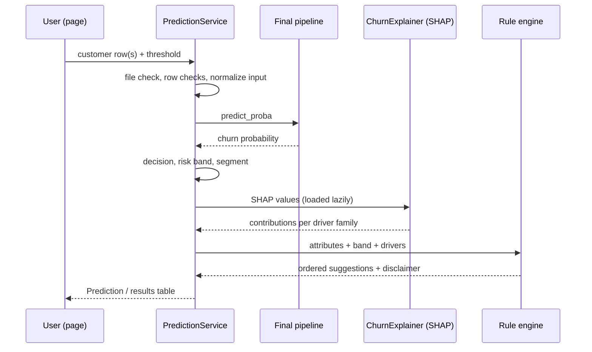

# Architecture

## Layers

| Layer | Package | Depends on | Never does |
|---|---|---|---|
| Config and logging | `churn.config`, `churn.utils` | `config.yaml` | Hard-code paths or seeds elsewhere |
| Data | `churn.data` | Config | Clean or transform data (that's the pipeline's job) |
| Features | `churn.features` | Data contract | Learn from validation or test rows |
| Modeling | `churn.models` | Features | Touch the test split, except `07 --evaluate-test` once |
| Explainability | `churn.explain` | Final model | Claim causation |
| Analytics | `churn.analytics` | Final model, features | Change a model probability |
| Serving | `churn.serving` | All of the above, artifacts only | Train anything |
| Frontend | `app` | Serving and saved artifacts | Train or re-select models |

## One pipeline for training and serving

The deployed object is a single `imblearn` pipeline, saved with joblib:

```
clean -> engineer -> preprocess (impute, scale, one-hot) -> model
```

- `clean` and `engineer` are stateless rules, so they're safe on one customer at a time.
- `preprocess` learns medians, means and category lists on the training split only.
- The pipeline is **flat**: `imblearn` rejects a nested pipeline as an intermediate step, because it must see every sampler to skip it at prediction time.

## Which split is used where

| Split | Rows | Used for |
|---|---|---|
| Train | 4,225 | Benchmark CV, tuning CV, fitting calibrators (internal CV), learning curves, segmentation, SHAP background |
| Validation | 1,409 | Comparing calibration methods, choosing thresholds, the selection rule, dashboards, explanations |
| Test | 1,409 | Opened **once**, after the model and threshold were fixed (`07 --evaluate-test`) |

## Artifact flow

| Script | Writes | Read by |
|---|---|---|
| 02 | `artifacts/eda/*` | README |
| 03 | `data/processed/*.csv`, `split_manifest.json` | 04 to 11, reproducibility tests |
| 04 | `artifacts/metrics/benchmark/*` | 05 (baseline), app page 6 |
| 05 | `artifacts/metrics/tuning/*`, `artifacts/models/tuned/*` (not committed) | 06, app page 6 |
| 06 | `artifacts/metrics/calibration/*`, `artifacts/models/candidates/*` (not committed) | 07, app page 6 |
| 07 | `artifacts/models/final/churn_pipeline.joblib`, `metadata.json`, `artifacts/metrics/final/*` | 08 to 11, service, app |
| 08 | `artifacts/shap/*` | App pages 1 and 7 |
| 09 | `artifacts/segmentation/*` (including `segment_model.joblib`) | 10, service, app page 5 |
| 10 | `artifacts/recommendations/*` | Service (rule settings), app page 8 |
| 11 | `artifacts/serving/*` | Service (SHAP background), app, Docker |
| 12 | `docs/test_report.md` | README |

## Serving sequence



## Security and packaging

- The Docker image uses an allowlist `.dockerignore`: only `src`, `app`, `.streamlit`, `config.yaml`, `pyproject.toml`, the requirement files and the needed artifacts.
- No raw data, `.env`, `.git`, MLflow database or training-only models are in the image.
- Runtime dependencies exclude XGBoost, LightGBM, CatBoost, MLflow and seaborn. The registry imports the boosting libraries only when building those models, and a test checks the serving path never imports them.
- The container runs as the non-root `appuser`. Only `/app/logs` is writable, and it's mounted as a volume.